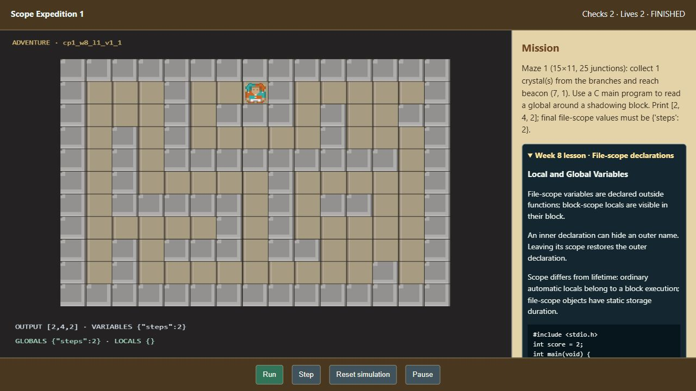
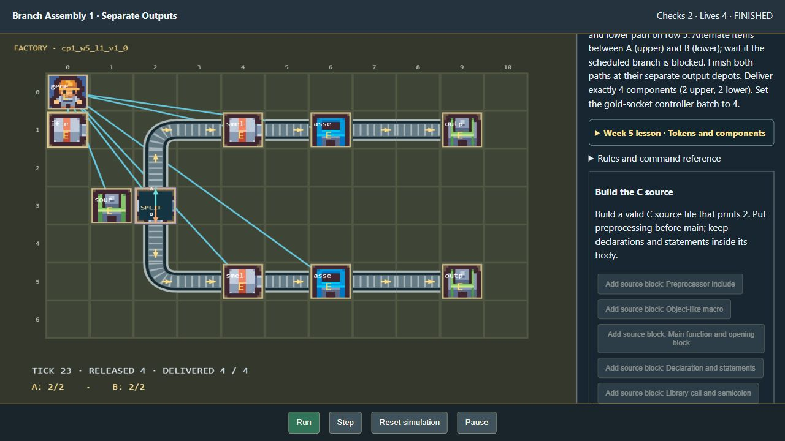
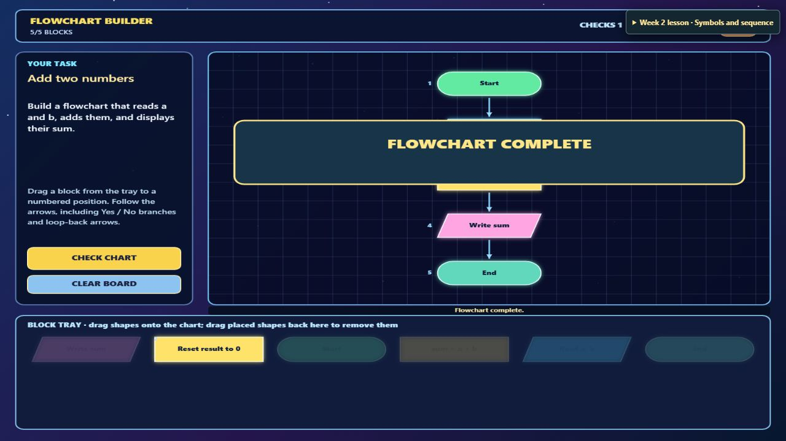

# Researched CP1 curriculum — verification

Completed 29 October 2026. Source material and implementation details are documented in `docs/CP1_CURRICULUM_INTEGRATION.md`.

## Automated checks

- Frontend suite: 107 passed.
- Executable references: all 1,710 programming missions, including the examination delegates, passed.
- Flowchart references: all 360 Week 2/examination flowcharts passed, plus the existing opening-region tests.
- Focused C-runtime suite: 4 passed after final identifier, literal, macro and scope guards were added.
- Package/selection suite: 37 passed. The curriculum/version/coverage test was rerun after final metadata updates and passed.
- Mirror check: 2,700 records, zero missing or stale definitions.
- Production frontend build: passed. The existing large-chunk advisory remains.

## Browser checks

The isolated preview used temporary pool copies, the real ZIP compiler and private extraction. It did not create participant accounts, rewards, study responses or assessment scores.

| Activity | Verified behavior |
| --- | --- |
| Week 8 Stage 1, Standard, variation 1 | Removing the file-scope `steps` declaration produced “Variable steps is not declared in this scope.” The corrected full C program printed 2,4,2, preserved global steps=2, navigated the maze and displayed “All goals verified. Mission complete.” |
| Week 7 Stage 1, Standard, variation 7 | A full C program declared `float resource`, added 0.5 and printed with `%.1f`. All three input/output streams passed and the mission completed. |
| Week 5 Stage 1, Needs Support, variation 1 | An empty source assembly was rejected. Six source blocks were then arranged and six keyword/identifier/directive categories selected. After controller/splitter placement and conveyor repairs, both source verification and branch production passed. |
| Week 9 Stage 1, Standard, variation 1 | Real pointer drags placed Start, Read, process, output and End. Checking the chart verified all sum cases and displayed “FLOWCHART COMPLETE”. The examination/source-week lesson label was also verified after the final guide update. |

No console warnings or errors were captured on the inspected game pages. Browser capture and long automation calls occasionally required reconnecting to the preview; assertions were based on the resulting visible completion/error states, not assumed success.

## Limits

The C practice interpreter implements its documented subset and simulated game API. It does not provide arbitrary native C compilation. Week 9 game stages cover Weeks 2–8 as examination practice; the existing published formal midterm and pretest/posttest scoring remain separate. No new learning outcomes, research records or formal instrument results were fabricated.
