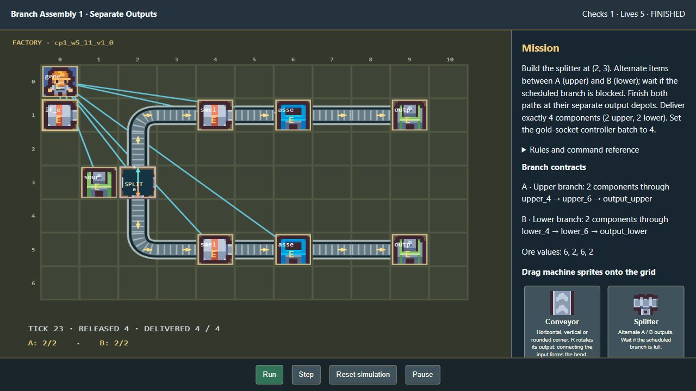
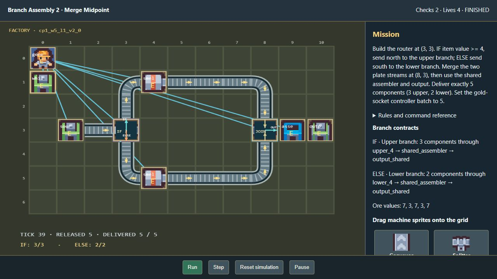
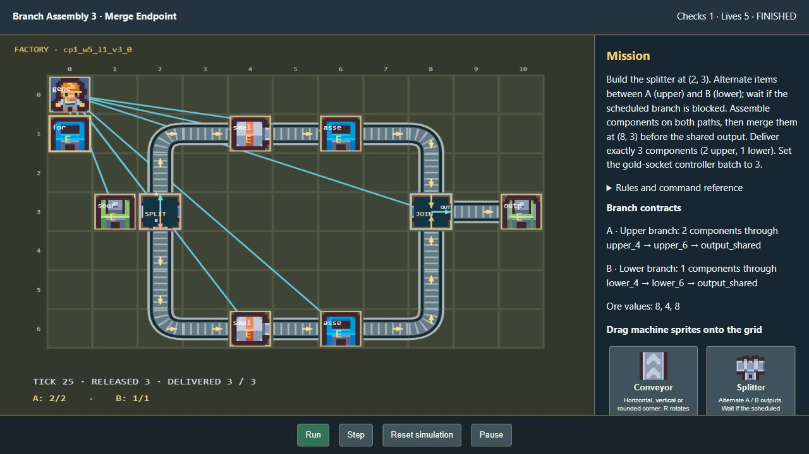

# Branching assembly verification

Verified locally on 29 October 2026 using disposable source copies, normal ZIP compilation and private extraction. Browser checks did not write participant, reward or assessment records.

## Delivered behavior

All 300 Week 5 definitions now use two actual production paths. Ten variations per stage/difficulty combine splitters or conditional routers with three topologies:

| Topology | Definitions | Processing and destination |
| --- | ---: | --- |
| Separate outputs | 120 | Each branch has a smelter, assembler and its own output depot |
| Merge midpoint | 90 | Separate smelters feed a merger, shared assembler and common depot |
| Merge endpoint | 90 | Separate smelters and assemblers feed a merger and common depot |

Splitters alternate A/B. Routers test actual item values using evenness or a numeric threshold and choose IF/ELSE. Blocked ports retain their item and branch choice. A one-slot merger alternates ready upstream inputs, leaving unaccepted items queued in upstream conveyors. Unique item IDs, processing histories, per-output totals and per-branch quotas prevent a correct grand total from hiding a wrong route.

The sprite tray supports real pointer dragging and a click/select plus numbered-grid alternative. Fork output directions, merger direction, router condition/threshold and batch size are editable in the inspector. Junctions and production machines need generator power. The three colored sockets identify the batch controller, fork and join positions.

## Browser evidence

| Tested Stage 1 configuration | Actions and result |
| --- | --- |
| Needs Support, variation 1 | Dragged splitter, repaired corner conveyors, set batch 4. Separate depots received A 2/2 and B 2/2; total 4/4 at tick 23. Mission complete. |
| Needs Support, variation 2 | Dragged router and merger, repaired conveyors, set batch 5. The initial wrong condition was rejected. Setting `value >= 4` routed values 7,3,7,3,7 to IF 3/3 and ELSE 2/2. Streams merged before the shared assembler; total 5/5 at tick 39. Mission complete. |
| Needs Support, variation 3 | Dragged splitter and merger, repaired conveyors, set batch 3. Both branches assembled components before joining; A 2/2 and B 1/1, total 3/3 at tick 25. Mission complete. |

The tested direct package pages had no browser console warnings or errors.

## Automated verification

- Full frontend suite: 103 tests passed.
- The focused model suite was then rerun with stronger merger fairness assertions: all 23 tests passed. The congestion fixture exercises simultaneous waiting inputs and verifies alternating acceptance.
- References execute successfully for all 2,100 executable weekly definitions, including all 300 new factories.
- Every factory also fails after reversing a required corner. Tests cover wrong router predicates, reversed IF/ELSE outputs, missing mergers, blocked branches, per-branch machine histories/destinations and conservation of released items through every frame.
- Focused package/selection suite: 36 tests passed, including all ten objectives rotating without repeats, cross-learner/restart isolation and shared asset existence.
- All 30 factory stage/difficulty pools contain ten distinct objective descriptions.
- Mirror check: all 2,700 canonical records match their mirrored definitions.
- Production frontend build passed; the existing large-JavaScript-chunk advisory remains.

## Files and limits

`scripts/factory_missions.py` authors the branch graphs; `scripts/programming_missions.py` delegates Week 5 to it. `scripts/build_canvas_games.py` updates canonical descriptions and mirrored definitions, referencing existing Kenney assets. `games/runtime/program-model.js` verifies and simulates item flow; `program-workbench.js` provides sprite placement, configuration, visual ports and branch delivery counters. `server/canvas_games.py` includes routing topology and branch targets in package descriptions.

This release supports one two-way fork and, when required, one merger per authored factory, with one source. It does not implement arbitrary nested branching, independent multiple sources, multi-ingredient recipes or a general C loop interpreter. Mergers queue and interleave items; they do not combine two items into a new ingredient. Batch controllers retain their existing finite production policies. Study adaptation, assessment scores and coin authority are unchanged.

Restart FastAPI after rebuilding the pool so its discovered catalog uses the latest definitions. An already extracted game keeps its embedded configuration; preparing a new mission loads the revised package.
