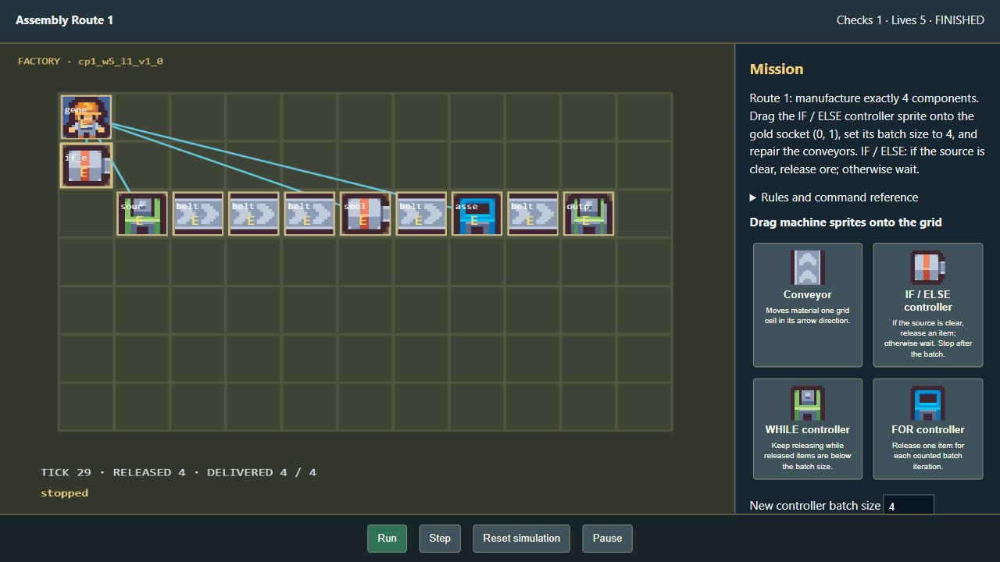
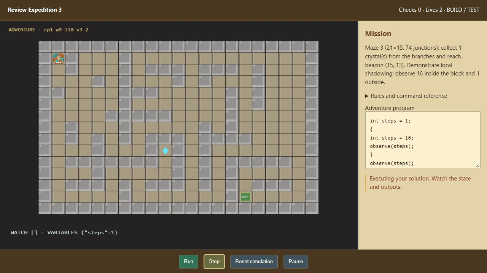
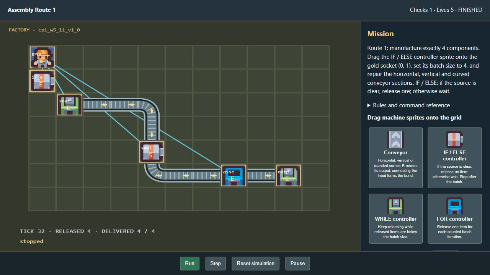

# Sprite assembly and branching adventure verification

Verified locally on 29 October 2026. The preview compiled disposable copies of source records into ZIPs and extracted them through the normal package helper. It did not write participant or study results.

## Assembly behavior

- Real pointer drags placed IF/ELSE, WHILE and FOR controller sprites from the palette into the gold socket; each run manufactured its exact target and displayed “All goals verified. Mission complete.”
- IF/ELSE: Week 5 Stage 1, Needs Support, variation 1, target 4. Missing conveyor sprites were also repaired using real pointer drags.
- WHILE: variation 2, target 5. Moving the placed controller off its socket produced “Drop the controller onto its gold socket.” Moving it back, repairing conveyors and running passed. The correction retained the original machine ID and power connection.
- FOR: variation 3, target 3. Controller pointer drop, conveyor repair, batch setting and execution passed.
- The factory has no text-code editor. Sprite cards and the mission describe the control rule and objective. Batch size is a numeric sprite property. Grid controls offer an alternative to pointer input.
- Controllers are preset production policies, not a general learner-authored loop interpreter.

## Adventure behavior

- The 900 adventure definitions contain 900 distinct map arrays.
- Width range: 13–21 cells; height range: 9–15 cells.
- Junction counts: 6–82. Minimum independent cycle count: 2.
- All 900 reference programs pass their actual movement, collectible, exit and observation checks as part of the model suite.
- Browser playback also passed Week 9 Stage 10, Advanced, variation 3: a 21×15 layout with 74 junctions, one crystal, exit (15,13), and inner/outer observations 16 and 1.
- No browser console warnings or errors were captured in the tested direct package pages.

## Automated checks

- Frontend: 97 tests passed, including reference execution for all 2,100 executable weekly definitions and adversarial model cases.
- Focused backend: 41 tests passed.
- Mirror check: 2,700 canonical definitions; no missing or stale mirrored games.
- Production frontend build passed. Vite still reports the existing large JavaScript chunk advisory.
- Week 4 remains the unchanged neutral challenge. The 240 historical Week 1 Stage 3–10 entries remain unavailable to learners.

These checks cover the revised simulators and packaging integration. They are not a complete study, security review or proof of every possible learner design. The mazes add route complexity; combat, enemies and new movement mechanics were not added.

## Follow-up: horizontal, vertical and rounded conveyors

All 300 assembly definitions now contain straight horizontal and vertical belt sections and editable corners. Production machines sit on straight cells, and missing pieces include a curved section. Conveyor geometry infers the incoming neighbor from its real output direction and draws a quadratic rounded bend when it is perpendicular to the outgoing direction. Rotation changes actual routing, not only the picture. Each transfer still uses one grid cell.

The frontend suite now passes 99 tests. New cases cover all four straight directions, all eight directed turns, rejection of false incoming neighbors, and broken production after reversing a required corner in every assembly definition. All 2,100 executable reference solutions continue to pass. The focused package suite also passed (35 cases).

Browser verification dragged both missing corner conveyors into Week 5 Stage 1, Needs Support, variation 1. One turned east-to-south and the other south-to-east. The completed route included a straight vertical section and delivered exactly 4/4 components at tick 32. It displayed “All goals verified. Mission complete.” with no console warnings or errors. The final 2,700-definition mirror check passed.

